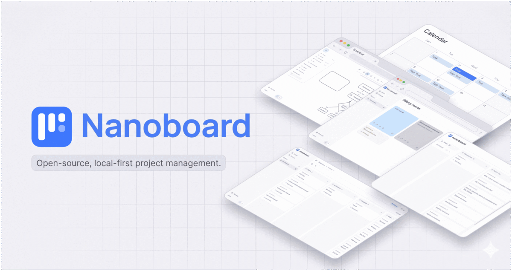

<p align="center">
  
</p>

<h4 align="center">
  <a href="https://nanoboard.pages.dev">Open the app</a> |
  <a href="#features">Features</a> |
  <a href="#quick-start">Quick start</a> |
  <a href="#project-structure">Project structure</a> |
  <a href="#built-with">Built with</a> |
  <a href="#contributing">Contributing</a>
</h4>

<div align="center">
  <h2>
    A minimalist, local-first project management workspace. </br>
    Kanban board, whiteboard, calendar, and sticky notes — fast, private, and 100% stored in your browser. </br>
  <br />
  </h2>
</div>

<br />
<p align="center">
  <a href="LICENSE">
    </a>
  <a href="https://github.com/ifelx74/nanoboard/actions/workflows/deploy.yml">
    </a>
  <a href="#contributing">
    </a>
  <a href="#features">
    </a>
  <a href="#features">
    </a>
  
</p>

<div align="center">
  <figure>
    <a href="https://nanoboard.pages.dev" target="_blank" rel="noopener">
      
    </a>
    <figcaption>
      <p align="center">
        Plan projects, sketch ideas, and keep everything private on your device.
      </p>
    </figcaption>
  </figure>
</div>

## Features

nanoboard supports:

- 🗂️&nbsp;Projects to organize your work.
- 📋&nbsp;Kanban board with drag-and-drop task management.
- 📝&nbsp;List view for a linear overview of tasks.
- 🖌️&nbsp;Infinite-canvas whiteboard powered by Excalidraw.
- 📅&nbsp;Calendar view to plan tasks by date.
- 🗒️&nbsp;Sticky notes for quick thoughts.
- ✍️&nbsp;Rich-text tasks with links, images, and checklists.
- 🔒&nbsp;Private by design — no account, no server; your data lives in your browser (IndexedDB).
- 📡&nbsp;PWA support — installable and works offline.
- 🌓&nbsp;Dark mode.
- 🪶&nbsp;Minimalist and fast.

## Quick start

**Requirements:** Node.js ≥ 24.20 and [pnpm](https://pnpm.io) (the exact version is pinned via `packageManager`; [Corepack](https://nodejs.org/api/corepack.html) picks it up automatically).

```sh
pnpm install
pnpm dev
```

Then open [http://localhost:5173](http://localhost:5173).

Other scripts, run from the repository root:

- `pnpm build` — build all apps and packages
- `pnpm test` — run tests with Vitest
- `pnpm lint` — lint the codebase
- `pnpm format` — format with Prettier

## Project structure

nanoboard is a pnpm + Turborepo monorepo:

- `apps/web/` — the only app: React 19, Vite, TanStack Router, Tailwind CSS 4, PWA.
  - `src/routes/` — TanStack Router file-based routes.
  - `src/components/` — feature components (`kanban-board/`, `whiteboard/`, `stickies/`, …) and shadcn/ui primitives.
  - `src/lib/db/` — the Dexie data layer: every read and write goes through here; data lives in the browser's IndexedDB.
  - `src/lib/editor/`, `src/lib/backup/` — TipTap rich text and export/import.
- `packages/` — shared ESLint and TypeScript config.

## Built with

- [React](https://react.dev) 19 and [Vite](https://vite.dev)
- [TanStack Router](https://tanstack.com/router) for routing
- [Tailwind CSS](https://tailwindcss.com) for styling
- [shadcn/ui](https://ui.shadcn.com) for the component system
- [Excalidraw](https://github.com/excalidraw/excalidraw) for the whiteboard
- [TipTap](https://tiptap.dev) for rich-text editing
- [Dexie](https://dexie.org) for local-first storage in IndexedDB
- [Zustand](https://github.com/pmndrs/zustand) for state management
- [dnd-kit](https://dndkit.com) for drag and drop
- [vite-plugin-pwa](https://vite-pwa-org.netlify.app) for PWA/offline support

## Deployment

Every push to `main` is built and deployed automatically by GitHub Actions to [nanoboard.pages.dev](https://nanoboard.pages.dev), hosted on Cloudflare Pages.

## Contributing

Missing something or found a bug? [Open an issue](https://github.com/ifelx74/nanoboard/issues). Pull requests are welcome — fork the repository, create a branch, and submit a PR against `main`.

## License

nanoboard is released under the [MIT license](LICENSE).
